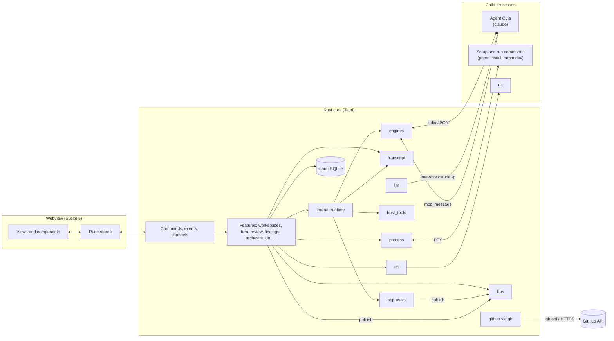

# Architecture

How Cormux is built. Product context lives in [`PRODUCT.md`](PRODUCT.md) and feature behaviour in [`features/`](features/README.md). This document says which part of the stack owns each piece of behaviour, and records the technical decisions that the feature specs depend on.

## Stack

| Layer | Choice | Role |
| --- | --- | --- |
| Native shell and backend | **Tauri 2.x (Rust)** | Desktop window, OS integration, and every side effect: git, processes, agents, GitHub, storage. |
| UI framework | **Svelte 5 + Vite** | Single page app rendered in the system webview. Runes (`$state`, `$derived`, `$effect`) drive fine-grained updates for streaming conversations, logs and diffs without a virtual DOM. |
| Components and styling | **Tailwind CSS v4 + bits-ui / shadcn-svelte** | Dark developer UI on accessible primitives: dialogs, command palette, popovers, menus, tabs, switches, resizable panes. |
| Icons | **lucide-svelte** | Status, git action and workspace state icons. |

The rest of this document adds libraries *inside* these layers. None of them change the stack.

### The one correction: PTYs are for apps, not agents

The stack brief says agent CLIs run "via PTY streams". A pseudo-terminal gives Cormux the same bytes a human would see in a terminal: a redrawing TUI full of ANSI escape codes. Every core feature of the conversation (tool-call steps, edit rows, plans, approval cards, findings) needs **structured events**, and scraping a TUI to get them would break on every CLI release.

So the backend runs two kinds of child process:

| Kind | Transport | Used for |
| --- | --- | --- |
| **Agent engines** | stdio pipes speaking a JSON protocol (Claude Code's stream-JSON) | Every thread. See [Engine adapters](#engine-adapters). |
| **Shell processes** | PTY | Worktree setup commands and the app's run command, so tools print colour and behave as they do in a terminal. See [Process supervisor](#process-supervisor). |

## Feature coverage

Each feature spec checked against the stack. "Supported" means the stack handles it with the libraries named here. "Needs a decision" means the stack can do it but the product hasn't said what it should do.

| # | Feature | Verdict | How |
| --- | --- | --- | --- |
| 01 | App shell and sidebar | Supported | Tauri overlay title bar with native macOS traffic lights; `sysinfo` crate for the memory meter; dock badge for pending approvals. |
| 02 | Command palette and shortcuts | Supported | bits-ui `Command` with its built-in filter off, so Cormux applies the spec's substring match on label and meta. Shortcuts are handled in the webview and mirrored in the native app menu. |
| 03 | Toasts | Supported | shadcn-svelte `Sonner` (svelte-sonner) inside a polite live region. OS notifications, a gap in the spec, come from `tauri-plugin-notification`. |
| 04 | Homebase and cards | Supported | Cards show what the core records (status, activity, PR, review); no model writes card text. |
| 05 | Open pull requests | Supported | Listed through the `gh` CLI's GraphQL API with the user's own `gh` login. See [GitHub](#github). |
| 06 | New workspace | Supported | `git worktree add` from the Rust git module; branch lists from `git for-each-ref`. The core drafts the name and branch from the goal (`naming`) and refines them with a small model call. |
| 07 | Worktree provisioning | Supported | Setup commands run in a PTY in the user's login shell environment, stop on first failure. |
| 08 | Teardown | Supported | Stop agents and the app by process group, then `git worktree remove` and `git branch -D`. |
| 09 | Workspace header | Supported | "Open in editor" and "Reveal in Finder" (spec gaps) via `tauri-plugin-opener`. |
| 10 | Thread tabs | Supported | One engine process per thread, all with the worktree as their working directory. |
| 11 | Agent conversation | Supported via structured protocol | Engine events map onto the timeline item kinds. Long threads need a virtual list; agent markdown needs sanitising. |
| 12 | Composer | Supported | Sending is a `user` message on the thread's stream-JSON stdin. **Pause can't be a true pause**; see [Pause semantics](#pause-semantics). |
| 13 | Approvals | Supported | Claude Code's `can_use_tool` control request blocks the agent until Cormux answers. The one policy, "Run everything", is enforced by the core; questions always wait for the user. |
| 14 | Changes panel | Supported | Filesystem watcher plus `git diff`; custom diff renderer with Shiki highlighting and jsdiff word ranges; `Resizable` panes. |
| 15 | Run app and Output | Supported | PTY per app in its own process group; ANSI to styled spans; port read from output; exit code gives the missing Crashed state. |
| 16 | Branch switching | Supported | `git switch`, refused with a clear message when the worktree is dirty. One core check (`workspace_git::check_new_branch`) vets every new branch name. |
| 17 | Pull and rebase | Supported (pull only) | Pull merges the base in; there is no rebase. Shared `git fetch` per repo; conflicts detected from exit status and unmerged paths. |
| 18 | Create PR | Supported | `git push` with the user's own credentials, then the GitHub API. The description is drafted by the small model call from the thread and the branch's diff against the PR's base: the branch below it in a `gh stack`, else the workspace's base. A stack that can't be read stops the PR rather than targeting trunk. |
| 19 | Review workspaces | Supported | `git fetch origin pull/<N>/head`, worktree on that ref, Reviewer thread. One per PR: the core reopens an existing one, moving its base if the PR was retargeted. |
| 20 | Review findings | Supported | The reviewer ends its reply with a JSON findings block that the core parses when its turn ends. A missing or malformed block is noted in the thread and the review stays running, so the reviewer's next reply is read again. Submit review uses the GitHub reviews API. |
| 21 | Settings | Supported | Persisted in SQLite; engine detection by resolving each CLI on the login-shell `PATH`. |
| 22 | Repos | Supported | Native folder picker (`tauri-plugin-dialog`); `git rev-parse --show-toplevel` validation, so a subfolder adds its repo, named after the top folder; default branch from `origin/HEAD`. |

Nothing in the specs needs a different stack. Former open decisions are recorded in [Decisions (MVP)](#decisions-mvp).

## System overview



**The Rust core is the source of truth.** The webview holds a mirror of state for rendering. It never spawns processes, reads files, or holds tokens. If the webview reloads, it asks the core for a snapshot and carries on.

## Rust core

Modules under `src-tauri/src/`, one concern each. A feature keeps its commands (`<feature>/commands.rs`, or a `commands` section), its SQL (an `impl Store` block beside it, e.g. `findings/store.rs`) and its row types together; `ipc/mod.rs` only lists the commands for registration.

**Dependency direction**, lowest first. A module only imports from the layers below it; `state` (the `AppState` every command borrows) is the composition root that wires the rest together, and the features' command adapters import it.

| Layer | Modules |
| --- | --- |
| Leaves | `error`, `model` (shared wire enums), `time`, `paths`, `shell_env`, `bus`, `media`, `timeline` (the core's step vocabulary) |
| Infrastructure | `store` (connections, migrations, repo/workspace/thread rows; imports only `model`, `error` and `time`), `git`, `process`, `llm`, `credentials`, `engines` (imports `shell_env`, `model`, `error` only), `workspaces` (the live workspace records over their rows) |
| Thread core | `transcript` (event log), `approvals` (broker), `thread_runtime` (live engines), `settings` (typed preferences) |
| Features | `turn`, `attachments`, `naming`, `workspace_start`, `provisioning`, `workspace_git`, `changes`, `teardown`, `repos`, `harness_config`, `review`, `findings`, `orchestration`, `host_tools`, `github`, `create_pr`, `pr_draft`, `stack`, `app`, `environment`, `terminal`, `thread_media`, `clickup`, `skills`, `scratch`, `entities`, `metrics`, `window_activity`, `feedback`, `snapshot` |
| Shell | `state`, `ipc`, `menu`, `lib` (startup order) |

Features don't call each other to react to something: they publish on the **bus** (`bus::DomainEvent`: `TurnEnded`, `ApprovalRequested`, `ProvisioningFailed`) and the features that care subscribe from their own `start` (orchestration, review, feedback). `turn` publishes `TurnEnded` once a turn has settled, `approvals` publishes `ApprovalRequested`, `provisioning` publishes `ProvisioningFailed`.

### Shell environment (`shell_env`)

macOS GUI apps don't inherit the user's shell `PATH`, so `claude`, `pnpm`, `nvm` and `uv` won't be found from a plain spawn. At launch, the core runs the user's login shell once (`$SHELL -l -i -c 'env -0'`), caches the result, and uses it for every child process. A **Reload environment** action re-reads it. This single step is what makes provisioning, Run and engine detection work.

### Repos and git (`git`)

Cormux shells out to the system `git` rather than using a library (`git2`, `gix`). That way it inherits the user's config, credential helpers, SSH keys, hooks and LFS, and a push from Cormux behaves like a push from the terminal. Output is read from porcelain and `-z` formats.

| Need | Command |
| --- | --- |
| Validate a repo | `git -C <path> rev-parse --show-toplevel` |
| Default branch | `git symbolic-ref refs/remotes/origin/HEAD`, falling back to `main` |
| Branches | `git for-each-ref refs/heads refs/remotes` |
| Create worktree | `git worktree add -b <branch> <path> <base>` |
| Review checkout | `git fetch origin pull/<N>/head:<local>` then `git worktree add <path> <local>` |
| Behind count | `git rev-list --count HEAD..<base ref>`, where the base ref is `origin/<base>` or the local base, whichever has everything the other has (`Git::freshest_ref`) |
| Diff | Uncommitted work (untracked files included) against `HEAD` through a scratch index; committed work as `git diff <base>...HEAD` |
| Switch branch | `git switch <branch>` (refused if `git status --porcelain` is not empty) |
| Pull | `git merge <base ref>` (as for the behind count); unmerged paths from `git diff --name-only --diff-filter=U` |
| Push (Create PR) | `git push -u origin <branch>` |
| Teardown | `git worktree remove [--force] <path>`, `git branch -D <branch>` |

**Worktree path:** `~/.harness/worktrees/<repo>/<branch-slug>`. Including the repo fixes the collision noted in [08](features/08-teardown.md).

**Fetching:** worktrees share one object store, so the core runs one background `git fetch` per repo (every 5 minutes and on window focus), then recomputes "behind" for every workspace on that repo.

**Live diffs:** a `notify` watcher on each worktree the webview subscribes to (and on one being set up), debounced to about 300ms and filtered through `.gitignore` (the `ignore` crate), triggers a diff refresh. The core sends the file list and per-file hunks; the UI never runs git.

Git calls for one worktree go through a per-worktree queue so two operations can't race on the index. `fetch`, `fetch_base`, `worktree_remove` and `gh stack view` skip it on purpose: they don't touch the index, and a slow network shouldn't hold the queue.

### Workspaces (`workspaces`, `workspace_start`, `provisioning`, `teardown`)

`workspaces` keeps each live workspace's record (its row plus `WorkspaceActivity`, how far setup got or what its review came to, which only the running app knows and the webview words); `workspace_start` names, records and provisions a Lead's workspace, `review` does the same for a PR review, and both hand `provisioning` a plan. Lifecycle (`model::WorkspaceLifecycle`):

```
provisioning → ready ⇄ running / paused / idle (from its threads' statuses) → tearingDown → archived
      ↓
provisioningFailed (retry, or skip setup and continue)
```

A workspace's status follows its threads': `store::set_thread_status` writes both in one transaction (`model::status_from_threads`). It is running while any thread works or starts (`ThreadStatus::is_working`), paused when its only unfinished threads are paused, and idle otherwise; the webview reads it and doesn't re-derive it. Setup ends through `Workspaces::finish_provisioning`, which writes the thread's status before the workspace's, so a workspace set up without a prompt ends ready.

- **Branch switch lock:** `workspaces::branch_lock` refuses while the workspace is provisioning or any of its stored threads is working, and says which. It is checked at execution time, as in [16](features/16-branch-switching.md), and the snapshot carries each locked workspace's reason for the header and Stack tab.
- **Provisioning:** the workspace and its thread (with the model and effort picked) are written in one transaction; then the worktree, setup commands in order, then the thread's first turn. Any error on the way marks setup failed, so it can be retried or skipped. Retry and Skip are refused unless setup failed, and Skip also when the worktree was never made.
- **Teardown order:** stop the thread's engine (a shutdown; the runtime waits up to `STOP_GRACE`, 6 s, while the session kills the engine after its own 5 s), stop the workspace's processes, remove the worktree, delete the branch if chosen, archive the row. A count git can't give (uncommitted files, unpushed commits) is treated as at risk in the preview, which also says whether to ask before tearing down (`askFirst`: uncommitted files, or a count git couldn't give).
- **Environment for setup and run:** `HARNESS_REPO_PATH` (the main checkout), `HARNESS_WORKTREE_PATH`, `HARNESS_WORKSPACE`, `HARNESS_BRANCH`, `HARNESS_BASE`. This replaces hard-coded paths like `cp ~/code/my-app/.env.local`.

### Engine adapters (`engines`)

The core of the product. Each thread is one long-lived engine process with the worktree as its working directory. Adapters translate each engine's native stream into one internal event model, and they are the only code that knows an engine's vocabulary: Claude's tool names, its `mcp__<server>__<tool>` naming and its CLI flags stay in `engines::claude`. A typed launch config yields both the CLI's arguments and its initialize handshake. A tool call reaches the rest of the app with a typed role (read, search, edit, command, fetch, web search, skill, MCP tool, subagent…), and permission requests and host tool calls arrive with a responder to answer them.

`thread_runtime` sits above the adapters: it keeps each thread's live engine, launches one in the thread's worktree when a prompt needs it, routes what it reports (events into the transcript, permission requests to the approval broker, host tool calls to `host_tools`), adds up cost, reports each turn's end once, and shuts down engines that sit idle. It holds no product prompts: what a session is told comes from functions it's given, like its host tools — `host_tools::session_config` for the tools and `workspace_start::session_brief` for the workspace (the branch instruction only for a Lead's first session on a branch off the default branch, plus how replies show media). An engine that fails to launch reports no turn end; its caller gets the error. Tests give it fake engines (`thread_runtime::fake`) or the mock CLI behind a `claude` shim on `PATH`.

`turn` is the only code that sends prompts and moves a thread's status: start (the user's message is saved first), pause and resume (interrupt and hold, with a queue), stop (records who stopped it; the engine reports the turn's end), new and resumed sessions, and settling a turn the engine ended before publishing `TurnEnded`.

`transcript` owns each thread's event log: it is the only writer of `thread_events`, it saves an event and then streams it to whoever watches the thread (so prompts, stops and the core's own steps stream like the engine's events), and everything else, the webview included, reads kinds and payloads only through it: `get_thread_events` sends decoded events with their time in milliseconds, and rows it can't read are logged and left out. It also defines a thread's conversations (`first`, then `after-<seq>` of the session step that began each other one): every saved and streamed event says which it is in, `get_thread_conversations` lists the ones to go back to, and resuming one picks its session in the core. A few signals are streamed but never saved: an engine exiting, a permission approved without asking, the tool a permission is waiting on, and a stream that lagged.

| Engine | Process | Protocol | Approvals arrive as |
| --- | --- | --- | --- |
| Claude Code | `claude -p --input-format stream-json --output-format stream-json --verbose --permission-prompt-tool stdio --await-initialize` | Claude stream-JSON, translated to engine events in Rust | `control_request` with subtype `can_use_tool` |

Claude Code gets a native Rust translator so Cormux doesn't have to bundle or require Node. Its control protocol is the one Anthropic's Agent SDK uses, but it's thinly documented; what Cormux relies on is written down at the top of `engines/claude/mod.rs`.

**Mapping to timeline items** ([11](features/11-agent-conversation.md)):

| Engine event | Timeline item |
| --- | --- |
| Agent message chunk | `thought` (streamed, rendered as sanitised markdown) |
| Tool call, role `read` / `search` / `command` / `fetch` / … | `tool` step, grouped into a run |
| Tool call, role `edit` | `edit` step linked to the Changes panel |
| Plan update | `plan` |
| Permission request | `approval` |
| `ReviewFindingsReady` step (recorded when a review's findings are read) | the `findings` card, in the thread that ran the review |
| Current tool call in progress | the live row's subtitle, replacing the prototype's rotating strings |
| Usage update | token and cost counters (a spec gap) |

**Sessions and restarts:** each thread stores its engine session id. After Cormux restarts, the thread resumes with `claude --resume <id>`.

**Engine detection** (Settings, [21](features/21-settings.md)): resolve each binary on the login-shell `PATH`, run `--version`, and check sign-in status (the `loggedIn` field of `claude auth status`'s JSON). Missing engines are shown as not installed rather than failing at workspace creation.

### Approval broker (`approvals`)

Owns each pending approval from request to answer: the stored row the card shows and the engine's waiter change together. `request` records the row and the waiter (or answers at once when the policy lets it through, and denies at once when the row can't be saved, since no card would show), `resolve` hands the answer to the engine and the row in one step, and `cancel_for_thread` drops a thread's open requests when its turn ends or its engine exits.

- **Policy:** "Run everything" approves every tool request without a card; questions always wait for the user. A session reads it when it starts.
- **Denials:** the user's reason goes back to the agent as the tool's answer, once.
- Pending counts feed the tab badges, sidebar, dock badge and OS notifications; requests are published as `ApprovalRequested` on the core's event bus, which orchestration uses to report blocked children.

### Host tools (`host_tools`)

A small MCP server inside the core, described by one table of tools: what a session is offered, which tools run without asking, what the agent is told and which calls are refused all come from it. Claude threads reach it over their existing stream-JSON connection rather than a separate process: `--mcp-config` declares an `sdk` server, the same name goes in `sdkMcpServers` on `initialize`, and each JSON-RPC message then arrives as a `mcp_message` control request. The session a message came through identifies the caller, so a tool can't act as another thread. Settings decide which tools a session is offered (`attach_entity` only while References is on); calls wait in a channel until the server has started.

| Tool | Approval | Purpose |
| --- | --- | --- |
| `create_thread` | Yes | Starts a new branch, worktree and child thread on a goal, and returns its id at once. |
| `list_threads` | No | The caller's children, or every thread in the repo, with status and branch. |
| `get_thread` | No | One thread's status, branch, last reply, PR, cost and pending approvals. |
| `read_thread` | No | The transcript, a page at a time. |
| `send_to_thread` | Yes | A follow-up message to a thread the caller started. |
| `mark_finding_fixed` | No | Marks a review finding the thread was sent as fixed; the last one closes the batch. |
| `attach_entity` | No | Pins a link to the References panel, while that experiment is on. |

Threads are visible within a repo only. A child can't start threads of its own, a parent has at most five active children, and only the user can answer a child's approvals.

Children report by push (`orchestration`): when one finishes a turn, is blocked on an approval or fails setup, its parent gets a `<thread_report>` prompt once it is idle, with waiting reports merged into one turn. Reports wait in memory, so one still queued at quit is lost; `list_threads` and `get_thread` recover the state.

Review findings come from the reviewer's reply, not from a tool: the core parses the findings block at the end of the reviewer's turn.

### Process supervisor (`process`)

Runs setup and run commands in a PTY (`portable-pty`) using the login-shell environment, each in its own process group so Stop, Restart and Teardown kill the whole tree.

- **Output:** read on a background task, split into lines, kept in a ring buffer (500 lines on screen, full log on disk for the session), and streamed to the UI in batches of about 30ms. Each line is a `LogEntry` with a kind: what a command printed, or Cormux's own command, marker, interrupt, note or warning lines, which the UI styles by kind.
- **Ports:** the port is read from the output (`localhost:<port>`, `127.0.0.1:<port>`, `0.0.0.0:<port>`). Cormux also sets `PORT` before spawning, which many frameworks respect: the app kind's usual port, moved past any other Cormux app's. This replaces the prototype's prediction.
- **Exit:** a non-zero exit while running becomes the **Crashed** state with the exit code and a Restart button.
- **Input:** the PTY accepts keystrokes, so dev-server shortcuts (`r`, `o`) are possible later without changing the design.
- **Quit:** on app exit, the core signals every engine's process group (`thread_runtime::kill_all`) and the supervisor stops every process it runs.

### GitHub (`github`)

Cormux keeps no GitHub token of its own: it uses the `gh` CLI's login. The PR list comes from `gh api graphql`; creating a PR and submitting a review use `reqwest` against the REST API with the token `gh auth token` prints, which never reaches the webview.

| Need | API |
| --- | --- |
| Open PRs involving the user | GraphQL search with `is:pr is:open` and `author:@me`, `review-requested:@me`, `assignee:@me`, `mentions:@me` |
| Checks and review state | `statusCheckRollup` and `reviewDecision` in the same query |
| Create PR | `POST /repos/{owner}/{repo}/pulls` after `git push` |
| Submit review | `POST /repos/{owner}/{repo}/pulls/{n}/reviews` with a verdict and line comments (`path`, `line`, `side`); findings outside the diff go in the review body |

Sync runs every 2 minutes and on window focus (at most once a minute, owned by `window_activity`). PRs are matched to registered repos by their `origin` remote URL, which fixes "which repo does this PR belong to" in [05](features/05-open-pull-requests.md).

### Small model calls (`llm`)

The PR description ([18](features/18-create-pr.md)) and name and branch refinement ([06](features/06-new-workspace.md)) use a fast, cheap model through the installed engine: a one-shot `claude -p --model haiku --output-format json`, on the sign-in the user already has. Each has a local fallback when the call fails or is slow (the goal's first words for a name, the goal for a PR's "why"). No model writes workspace or card text.

### Storage (`store`)

SQLite (`rusqlite`, bundled) in the app data directory. Settings, repos and repo config, workspaces, threads, the full timeline of each thread as an append-only event log, approvals, findings, and a PR cache. Keeping transcripts here means a workspace's history can outlive its worktree, which answers the "transcripts are lost on teardown" gap in [08](features/08-teardown.md) if the product wants an archive.

Repo config can also be read from a committed file (`.cormux/config.json`) so a team shares setup and run commands, with Settings as a local override.

**Migrations** run in version order inside `Store::open`: the SQL files in `src-tauri/migrations/`, plus Rust migrations their owning module supplies (024 is `transcript::MIGRATION`, which rewrites rows older builds saved). Each runs in its own transaction and is recorded in `schema_migrations`.

**Settings** (`settings::Settings`) are one typed struct, stored one row per field under the field's wire name; it names their keys and defaults (the webview gets the defaults as the generated `DEFAULT_SETTINGS`), except the PR sync's `githubPrSyncedAt` marker row and the terminal app's default (`terminal`). The webview reads them with the snapshot and writes them with `update_settings` and a patch, which returns them as stored. The ClickUp API key is kept in `~/.cormux/credentials.json`, not in the database.

**Snapshot** (`snapshot`): what the webview loads in one go — every feature's rows read in one read transaction, plus the state only memory holds (live workspace records, git counts, running apps, memory, pending approval count). Every state change the core announces (`feedback::Notifier::changed`) bumps a version the snapshot carries; the webview refetches on each, and `repoGit` marks a change that also moved `origin`.

### Metrics (`metrics`)

`sysinfo` sums resident memory for the Cormux process and every process it started (engines, setup, apps), sampled every 4 seconds (every minute while the window is in the background). The webview's content process is an XPC service, not a child, so it isn't counted. The meter shows the total.

## IPC

| Mechanism | Direction | Used for |
| --- | --- | --- |
| **Commands** (`#[tauri::command]`) | UI → core | Every action: create workspace, send message, approve, run app, create PR. Typed request and response. |
| **Channels** (`tauri::ipc::Channel`) | core → UI | High-volume ordered streams: agent message chunks, PTY output, diff updates. One per subscribed thread or log. |
| **Events** | core → UI | `StateChanged { version, change: { repoGit } }` after anything the snapshot shows changed, toasts, memory samples and menu choices. |

TypeScript types for commands and payloads are generated from the Rust definitions (`tauri-specta`) so the two sides can't drift, and so are the constants the webview shares with the core: `DEFAULT_SETTINGS`, `MEDIA_EXTENSIONS` (what a thread shows as an image or video) and `WORKING_THREAD_STATUSES`. Every state event carries a version number; if the UI sees a gap, it re-fetches a snapshot.

The webview only subscribes to streams it's showing. A background thread keeps its state in the core; switching to it loads recent items and then subscribes.

## Frontend

### Layout

```
src/
  lib/
    ipc/          generated bindings, channel helpers
    core/         sync (snapshot refresh, version guard, state events), nav (one Route and navigate)
    state/        cross-cutting rune stores: workspaces, threads, repos, scratches, prs, workspace UI
    nav/          opening a place: a workspace on a thread or panel, Changes at a file
    <feature>/    a feature's logic, store, actions and components together: changes, run-app,
                  clickup, settings, bangs, thread, composer, findings, command-palette,
                  switcher (Ctrl+Tab), sidebar, …
    settings-page/ the Settings page: composes each feature's settings panel
    components/
      ui/         shadcn-svelte components (generated, owned by the repo)
      shell/      app shell, lazy views, and the app's input routers: menu bar and keyboard
      workspace/  header, conversation, composer, approvals, findings
```

The core sync is the only code that fetches or applies a snapshot: one coalesced refresh that drops a snapshot older than the last one applied. Each store registers its own slice with `onSnapshot`; actions that change something await `refreshSnapshot()`. Stores hold data and return errors; actions and components decide whether to toast. Where the app is lives in one `Route` value; one-shot intents (a settings section, a diff line to reveal, focus on Findings) are route fields the target view takes once.

State lives in class-based rune stores (`$state` fields, `$derived` getters). Derived values, like a card's "Needs Attention" badge or the sidebar's "N working", are `$derived` from thread state so they never go stale. Thread timelines are append-mostly arrays; fine-grained reactivity means a streaming chunk updates one text node, not the conversation.

### Components mapped to shadcn-svelte and bits-ui

| Spec element | Component |
| --- | --- |
| Command palette | `Command` inside `Dialog` |
| New workspace, Create PR, Teardown confirm | `Dialog`, `AlertDialog` |
| ⋯ menu, branch picker | `DropdownMenu` (with `RadioGroup` items for branches) |
| Row overflow menus (spec gap) | `ContextMenu` |
| Thread, Findings and Output tabs | `Tabs` (roving focus and arrow keys built in) |
| Settings switches, default engine | `Switch`, `RadioGroup` |
| Findings checkboxes | `Checkbox` (supports indeterminate) |
| Conversation and Changes split | `Resizable` (paneforge) |
| Filters (All / Running / Idle) | `ToggleGroup` |
| Tooltips on locked controls | `Tooltip` |
| Toasts | `Sonner` |

### Specialised rendering

- **Diffs** ([14](features/14-changes-panel.md)): a custom Svelte renderer over hunks from the core. Syntax highlighting with **Shiki** (JavaScript regex engine, grammars loaded on demand); word-level ranges from **jsdiff**. Unified and split layouts share one data model. CodeMirror's merge view is the upgrade path if an in-app editor arrives.
- **Conversation**: agent text rendered as markdown (`marked`), sanitised with **DOMPurify** before insertion. Finished replies render diff, chart, JSON, math and test-output blocks as components, and **Mermaid** diagrams and **KaTeX** math load on demand. Threads longer than a few hundred items use a virtual list (`@tanstack/svelte-virtual`), or older tool runs collapse.
- **Output log**: ANSI colour codes converted to styled spans (`anser`). The log is 500 lines, so no virtualisation. If full terminal emulation is ever needed, `xterm.js` drops into the same panel.

### Window and platform

- Overlay title bar with hidden title and native traffic lights; the sidebar's top strip is a `data-tauri-drag-region`. The prototype's decorative window controls are replaced by the real ones.
- Minimum window size of about 960 × 600. The prototype's stacked layout below 760px isn't needed on desktop.
- A native app menu mirrors the shortcuts (`⌘K`, `⌘N`, `⌘,` for Settings) so they're discoverable. `⌘N` doesn't conflict with anything in a Tauri window.
- `prefers-reduced-motion` works in WKWebView; the in-app switch adds a `reduce-motion` class as specified.

## Security

Agent output is untrusted and the webview can call backend commands, so an injected script would be dangerous.

- **Strict CSP**; no remote scripts or content. Links from agent text open in the default browser via the opener plugin, never in the webview.
- **No generic shell access from the UI.** The Tauri shell plugin isn't exposed. The core only runs commands it builds itself: git, configured setup and run commands, and engine binaries.
- **Capabilities** grant the webview only Cormux's own commands and the dialog, opener and notification plugins.
- **All agent text is sanitised** before rendering; `{@html}` is only used on sanitised output.
- **Secrets** stay in Rust: GitHub through the `gh` login, the ClickUp key in `~/.cormux/credentials.json`.

## Performance budget

| Measure | Target | Note |
| --- | --- | --- |
| App bundle | about 10 MB | Rust binary plus frontend assets. Shiki grammars add a few MB if bundled rather than lazy-loaded. |
| Rust core, idle | 15 to 30 MB | The stack's figure. |
| Webview process, idle | about 50 to 120 MB | WKWebView runs in its own process and isn't included in the figure above. |
| Per agent thread | 150 to 400 MB | The engine CLI's own footprint, outside Cormux's control. This dominates the memory meter. |
| Streaming | 60 fps while an agent streams and an app logs | Batching on channels and fine-grained updates. |

The stack's 15 to 30 MB claim holds for the core, but the number users see in Activity Monitor will be larger because of the webview and, above all, the agents. The memory meter should say so honestly.

## Platforms

macOS first. Tauri, `portable-pty` (ConPTY on Windows) and the git approach all work on Windows and Linux, but three things need work there: login-shell environment resolution, process-group termination (job objects on Windows), and WebKitGTK's weaker CSS support on Linux.

## Decisions (MVP)

Closed under epic COR-31. Product-facing summary in [`PRODUCT.md` → Decisions (MVP)](PRODUCT.md#decisions-mvp).

| ID | Shipped behaviour |
| --- | --- |
| COR-207 | **Engines:** Claude (stream-JSON) only. Other engines were dropped; migrations 014 and 018 turn their threads into Claude threads. |
| COR-208 | **GitHub auth:** the `gh` CLI's login (`gh auth token`); Cormux stores no token. **Reviews:** findings with a path and line go as line comments; if GitHub refuses one (422), they all go in the body. |
| COR-209 | **Small model:** `LlmClient::complete` runs `claude -p --model haiku --output-format json`, for PR descriptions and names only. |
| COR-210 | **Quit:** `RunEvent::ExitRequested` → `thread_runtime::kill_all` (engine process groups) and `process.stop_all()`. **Teardown:** `stop_threads` sends `EngineCommand::Shutdown` then waits up to `STOP_GRACE` (6 s, just over the session's own 5 s) per thread. |
| COR-211 | **Archive:** Teardown sets `workspaces.archived_at` and clears `worktree_path`; timeline events stay in SQLite. Active queries filter `archived_at IS NULL`. |
| COR-212 | **Changes review:** no per-file approve step; Discard (`discard_workspace_changes`) is the one write from the Changes panel. |
| COR-213 | **Approvals:** one policy, "Run everything" (`ApprovalPolicy` from Settings): every tool request is approved without a card; questions always wait. Without it every request shows a card. |
| COR-214 | **Skills:** `SkillsSettings` empty state only; no persistence or session injection. |
| COR-215 | **No in-app editor/tree.** Conflicts: `abort_workspace_git` backs out a pull. Workspace header opens the worktree in the OS editor/Finder via the opener plugin. |
| COR-216 | **UI stack:** `components.json` style `nova`; `@fontsource-variable/geist` fonts; Tailwind v4 + shadcn-svelte. |
| COR-217 | **One thread per workspace:** a new thread is a new workspace (its own branch and worktree); agents start them with `create_thread`. |
| COR-218 | **License:** `Cargo.toml` `license = "UNLICENSED"`; no payment or entitlement checks in app. |

### Pause semantics

The composer's Pause ([12](features/12-composer.md)) can't freeze an agent mid-thought. Suspending the process (`SIGSTOP`) would leave its model request hanging until the API times out. The realistic behaviour is **interrupt and hold**: Pause cancels the current turn (Claude Code's interrupt), the thread shows "Paused by you", messages typed while paused are queued, and Resume sends the queue (or "continue") as the next turn. An in-flight tool call is either allowed to finish or cancelled with it, depending on the engine.

## Protocol notes

The spikes that settled the Claude control protocol, the login-shell environment, PTY app lifecycle and streaming load are done; what they found is in the code it shaped: `engines/claude/mod.rs` (handshake, permission prompts, interrupt, resume, background agents, host MCP over the same stream), `shell_env.rs` and `process/`.
